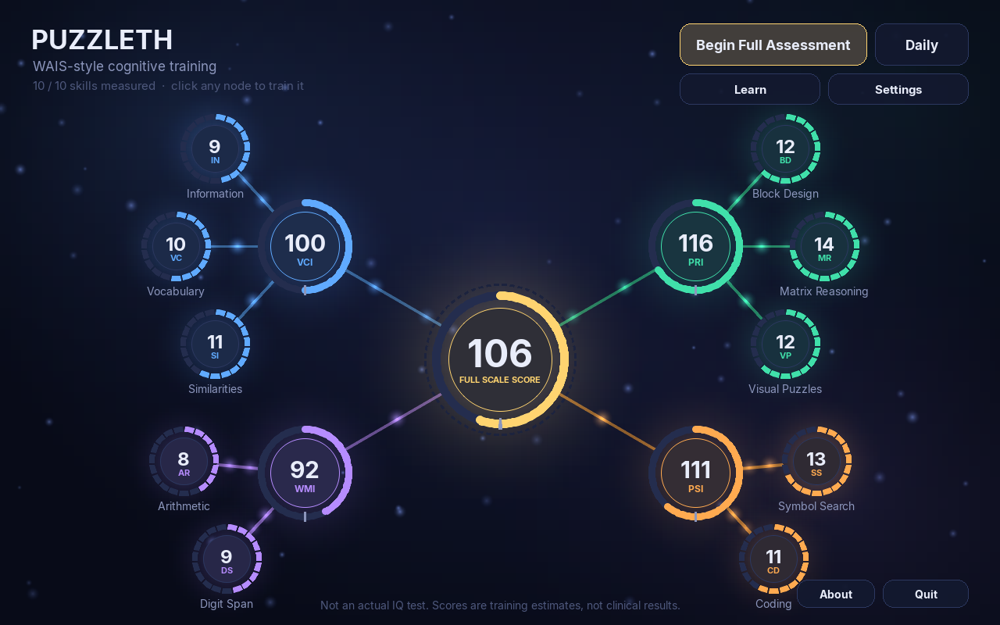
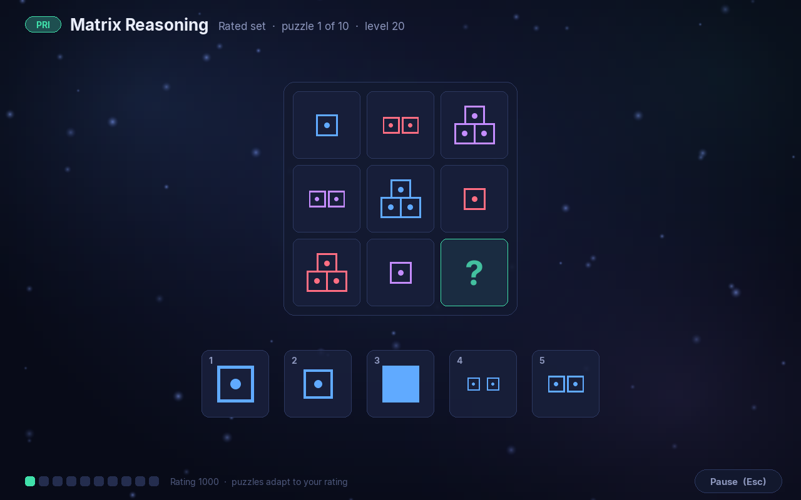
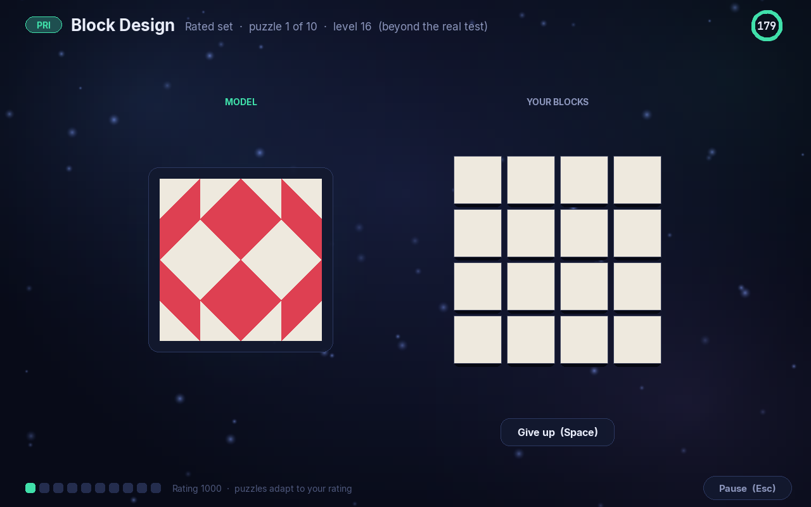
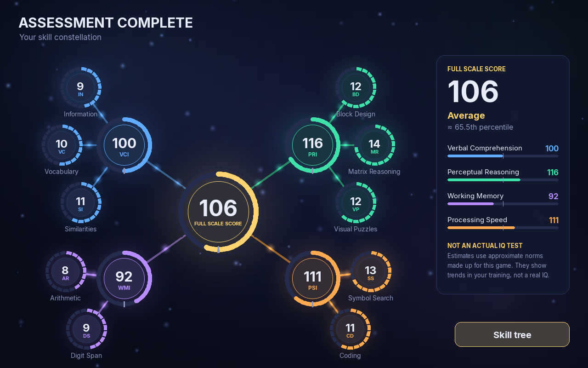
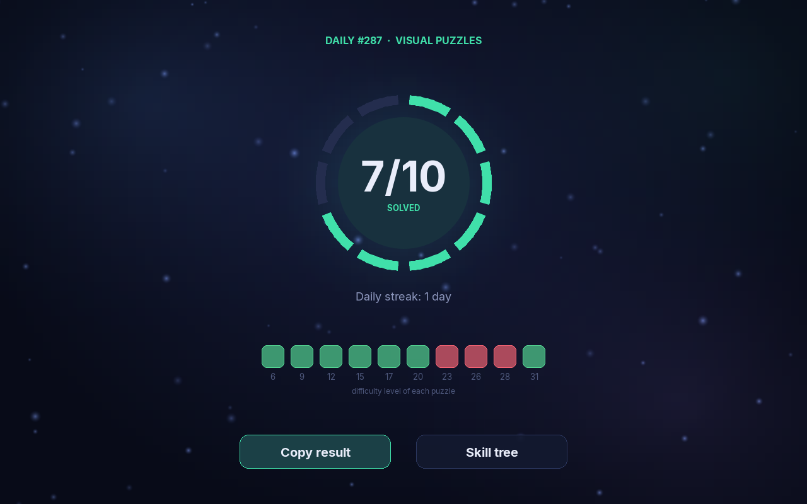

# Puzzleth

A puzzle game built on the structure and rules of a real intelligence test, the WAIS-IV. Every
puzzle is generated fresh, your skills grow as a constellation of skill-point rings, and harder
puzzles keep coming after the real test runs out.



> **This is not an actual IQ test.** It is not the WAIS, uses none of its items, and its scores
> come from approximate norms made up for this game. They can't be compared with a real IQ, can't
> diagnose anything, and must not be used for school, work, legal or medical decisions.

## Who it's for

- **If you're nervous about an upcoming assessment.** Learn what a real session is like: the
  examiner who won't say if you're right, the timers, going back to easier items, being stopped
  after a few misses. A short walkthrough explains each of these before your first full run, and
  you can hide all test-style scores so you can rehearse without worrying about a number.
- **If you want a challenge.** Rated puzzle sets work like a chess puzzle rating, and difficulty
  keeps climbing past the real test's hardest item. The daily challenge gives everyone the same
  ten puzzles each day, with a result you can copy and share.
- **If you're just curious.** The Learn screen explains how the test works, what each subtest is
  for, how to read the scores, and some common IQ myths.

## Play in your browser

**[vn0v4.github.io/Puzzleth](https://vn0v4.github.io/Puzzleth/)** works on phones, tablets and
computers, with nothing to install. Hold your phone sideways. Puzzleth saves your progress in that
browser. On a phone, "Add to Home Screen" gives it its own icon and more room on screen.

The first load downloads about 15 MB (a Python runtime that runs in the browser). Later visits are
faster.

## Run it on your computer

```sh
git clone https://github.com/VN0V4/Puzzleth.git
cd Puzzleth
./puzzle
```

`./puzzle` uses your Python if it has [pygame-ce](https://pyga.me), or `nix-shell` if you're on
Nix. Otherwise install it first (Python 3.10 or newer):

```sh
pip install -r requirements.txt
python3 main.py
```

Your progress is saved to `~/.puzzleth/profile.json`.

Everything works with a mouse or touch screen: on-screen keypads, Confirm, Give up and Pause
buttons appear where a keyboard would otherwise be needed.

**Sound.** Digit Span reads the digits out loud, one per second, as in a real session. Timers tick
in their last five seconds, and right/wrong chimes play only when feedback is on, so the full
assessment never gives anything away. Settings has separate volumes for sound effects and music.

**Your own music and sounds.** Put `.mp3`, `.ogg` or `.wav` files in `puzzleth/music/` and they
play in a shuffled loop, each fading in and out. To change any sound effect or the spoken digits, add a file with the same
name to `puzzleth/sounds/`; [puzzleth/sounds/README.md](puzzleth/sounds/README.md) lists every
sound and when it plays. On the desktop you can use `~/.puzzleth/music/` and `~/.puzzleth/sounds/`
instead, leaving the game's own folders untouched.

**Keys:** Enter starts the full assessment, D opens the daily challenge, L opens Learn, F11
toggles fullscreen, and Esc pauses during a subtest. Each subtest's intro screen shows its own
controls.

## Ways to play

| Mode | What it is |
|---|---|
| **Full assessment** | All ten core subtests in the real order and under test conditions: no feedback, real time limits, real stopping rules. Ends with your index scores and a Full Scale Score. |
| **Training** | Click any node in the skill tree to practise one subtest under the real rules, with optional feedback after every item. |
| **Rated sets** | Ten puzzles matched to your puzzle rating (Matrix Reasoning, Visual Puzzles, Block Design, Arithmetic). Available from each of those subtests' intro screens. |
| **Daily challenge** | Ten puzzles from one subtest, from easy to beyond the real test. Everyone gets the same puzzles each day, and only your first try counts. |
| **Learn** | What to expect in a real session, the ten subtests, the four indexes, how scores work, myths and facts. |

<p>
  
  
  
  
</p>

## The subtests

| Index | Subtest | Notes |
|---|---|---|
| Verbal Comprehension | Similarities, Vocabulary, Information | Multiple choice, with options written to match WAIS 2/1/0 scoring |
| Perceptual Reasoning | Block Design, Matrix Reasoning, Visual Puzzles | Fully generated; every puzzle is checked to have exactly one solution |
| Working Memory | Digit Span (forward, backward, sequencing), Arithmetic | One digit per second; Arithmetic hides the problem after it has been "read" |
| Processing Speed | Symbol Search, Coding | 120-second limits; Coding uses a symbol-to-digit key |

The WAIS administration rules are built in: adult **start points**; **reversal**, where earlier
items are given in reverse until two in a row are fully right, with full credit for the easier
items skipped; **discontinue** rules; per-item **time limits**; and Block Design **speed bonuses**.

## How scoring works

**Test-style scores.** `scaled = 10 + 3·(raw − mean)/SD`, clamped to 1–19. Index scores and the
Full Scale Score come from the mean z-score of their subtests, corrected for how closely the
subtests correlate: `z = mean_z / sqrt((1 + (n−1)·r) / n)`, then `score = 100 + 15·z`. The means
and SDs are estimates tuned to this game, not real norms. Hide these scores any time in Settings.

**Puzzle rating.** Each difficulty level has a nominal rating. Level 1 is about 650, and the real
test's last item is 1800. After each puzzle your rating moves the Elo way:
`rating += K·(result − expected)`. Puzzles are picked near your rating, so you solve about half.
Levels past the real test add things like 4×4 Block Designs, five-rule matrices, bigger Visual
Puzzles and multi-step word problems.

## Notes

- **English only.** Vocabulary, Similarities, Information and Arithmetic are written in English
  and assume some general Western knowledge. Translations are welcome.
- **Practice effects.** Practising test formats can raise scores on a real test. If you are
  assessed by a professional, tell them you've practised.
- **Trademarks.** WAIS and Wechsler Adult Intelligence Scale are trademarks of their owner, NCS
  Pearson, Inc. This project is independent and not affiliated with or endorsed by them; the
  names are used only to describe what the game is modelled on.

## Development

```sh
python3 -m unittest discover -s tests   # or: nix-shell --run "python3 -m unittest discover -s tests"
python3 tools/screenshots.py            # regenerate the images in docs/screenshots
tools/make_sounds.py --voice en_US-ljspeech-high.onnx   # regenerate puzzleth/sounds (needs ffmpeg, piper)
```

**Web version.** [pygbag](https://pygame-web.github.io) compiles the same code to WebAssembly.

```sh
pip install pygbag==0.9.2
tools/build_web.sh --serve   # try it at http://localhost:8000
tools/build_web.sh           # static site in build/web/, ready for any web host
```

The build converts any `.mp3` and `.wav` files in `puzzleth/sounds/` and `puzzleth/music/` to
`.ogg`, which every browser plays, so it needs `ffmpeg` if you've added some.

The GitHub Actions workflow in `.github/workflows/web.yml` runs the tests, then builds and
publishes the site to GitHub Pages on every push to `main`. To turn it on, open the repository's
Settings > Pages and set Source to "GitHub Actions".

The tests cover the administration rules, the scoring and rating maths, and the generators. For
the generators, they check thousands of random seeds for a unique matrix answer, exactly one
Visual Puzzles solution, integer arithmetic answers, and valid Symbol Search rows. They also check
that daily puzzles are identical for every player.

## License

[MIT](LICENSE). The bundled fonts, [Inter](https://github.com/rsms/inter) and
[JetBrains Mono](https://github.com/JetBrains/JetBrainsMono), are under the SIL Open Font
License (see `puzzleth/fonts/`). The web page template is adapted from pygbag's (MIT). The sound
effects are synthesized by `tools/make_sounds.py`, and the spoken digits were made with
[Piper](https://github.com/rhasspy/piper)'s LJSpeech voice, whose recordings are public domain.

**Music.** [“Meditation - Meditation Music”](https://pixabay.com/music/meditationspiritual-meditation-meditation-music-581020/)
by **andriig** on Pixabay, in `puzzleth/music/`, is used under the
[Pixabay Content License](https://pixabay.com/service/license-summary/). It isn't covered by this
project's MIT license.
